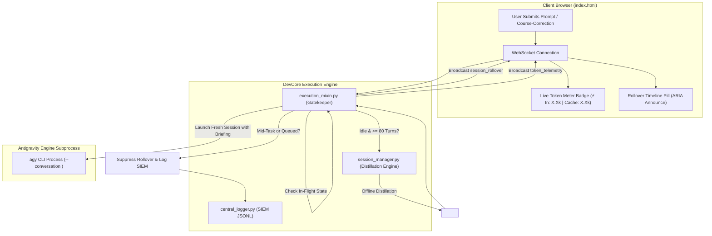

[//]: # (DOC_ID: SIRA-DEV-04_39 | VERSION: v1.0 | SCOPE: DEV)

# Pillar 04.39: Solutions & Architecture: Automated Silent Session Rollover & In-Flight Protection

[//]: # (SECTION_ID: SIRA-DEV-04_39-SEC-1)
## 1. Architectural Overview & Context
[//]: # (SECTION_ID: SIRA-DOC-04_39-SEC-1)
The Automated Silent Session Rollover and Context Transfer architecture prevents token runaway and context saturation in long-running agentic conversations. When conversations accumulate tens of thousands of tokens over dozens of turns, the system distills core working state offline, transfers context to a fresh conversation ID seamlessly, and protects mid-task workflows from unintended resets.

---

[//]: # (SECTION_ID: SIRA-DEV-04_39-SEC-2)
## 2. The 4 Modular Components
[//]: # (SECTION_ID: SIRA-DEV-04_39-SEC-1)

### Component 1: Context Distillation Engine (`core/session_manager.py`)
[//]: # (SECTION_ID: SIRA-DOC-04_39-SEC-1)
- **Offline Working State Extraction**: Parses `transcript.jsonl` directly without making cloud LLM calls, protecting against additional latency and token consumption.
- **Traversal-Safe Turn Counting**: Rejects path traversal escapes (`..`, `/`, `\`) and non-existent IDs.
- **Briefing Formulation**: Distills active workspace directory, active project, recent user goals, recent outcomes, and touched files into a standardized `<SESSION_CONTINUATION_CONTEXT>` envelope.

[//]: # (SECTION_ID: SIRA-DEV-04_39-SEC-2)
### Component 2: Autonomous Rollover Gatekeeper (`agents/mixins/execution_mixin.py`)
[//]: # (SECTION_ID: SIRA-DOC-04_39-SEC-2)
- **In-Flight Task Protection**: Tracks `_from_steer_or_queue` and inspects `queued_prompts`. If a turn is an active steering update or follow-up execution, rollover is unconditionally suppressed.
- **Cache Trap Elimination**: Removed naive `last_cache >= 75000` triggers. Standard Gemini prompt cache hits never cause premature session wipes.
- **Opt-In Safety Boundary**: Automatic rollover defaults to disabled (`ENABLE_AUTO_SESSION_ROLLOVER=false`). When explicitly enabled, rollover only triggers at high turn counts (`>= 80`) when idle between tasks.
- **Subprocess Hygiene**: Removed indiscriminate system-wide `pkill` calls on turn exits, preserving active background tasks and subagents.

[//]: # (SECTION_ID: SIRA-DEV-04_39-SEC-3)
### Component 3: Frontend Synchronization (`sandbox/templates/index.html`)
[//]: # (SECTION_ID: SIRA-DOC-04_39-SEC-3)
- **`session_rollover` Handler**:
  - Updates `currentConversationId` and syncs `localStorage`.
  - Dynamically registers the new conversation in the sidebar dropdown.
  - Dispatches an accessible screen-reader announcement via `announce(rollMsg, false)`.
  - Appends a high-contrast visual timeline pill into `#chat-history`.
- **`token_telemetry` Meter**:
  - Dynamically updates the `#token-usage-badge` in the portal status bar with `aria-label="Session Token Usage"`.

[//]: # (SECTION_ID: SIRA-DEV-04_39-SEC-4)
### Component 4: Security Audit Guard Invariants (`security/security_audit.py`)
[//]: # (SECTION_ID: SIRA-DOC-04_39-SEC-4)
- **Static AST SAST Verification**: Automatically inspects AST of `execution_mixin.py` to guarantee that `_from_steer_or_queue` is accepted, `is_ongoing_midconversation` is enforced, no `last_cache >=` triggers exist, and no blanket `pkill` is present.
- **Permutation Invariant Verification**: Simulates all 5 operational permutations to ensure rollover is blocked during steer/queue and disabled by default.

---

[//]: # (SECTION_ID: SIRA-DEV-04_39-SEC-3)
## 3. Screen Reader & Accessibility Considerations
[//]: # (SECTION_ID: SIRA-DOC-04_39-SEC-3)
- **No Raw Alert Spam**: Rollovers do not interrupt active speech or screen reader focus; announcements are queued via `announce()` to live regions.
- **Accessible Token Meter**: `#token-usage-badge` contains semantic ARIA labels (`aria-label="Session Token Usage"`) so screen reader users navigating by landmarks can read current token costs without opening devtools.
- **Timeline Pills**: Visual pills in chat history utilize `role="status"` and clean text without extraneous ASCII art.

---

[//]: # (SECTION_ID: SIRA-DEV-04_39-SEC-4)
## 4. Cross-Reference Navigation
[//]: # (SECTION_ID: SIRA-DOC-04_39-SEC-4)
- **Problem Statement**: [`01_PROBLEMS_ENCOUNTERED/01_43_TOKEN_BURST_PREMATURE_ROLLOVER_AND_MIDTASK_RESET_TRAPS.md`](/docs/devlog/01_43_TOKEN_BURST_PREMATURE_ROLLOVER_AND_MIDTASK_RESET_TRAPS)
- **Source Code Evidence**: [`02_SOURCE_EVIDENCE/02_39_SESSION_ROLLOVER_DISTILLATION_AND_GUARD_EVIDENCE.md`](/docs/devlog/02_39_SESSION_ROLLOVER_DISTILLATION_AND_GUARD_EVIDENCE)
- **Diagnostic Test Logs**: [`03_DIAGNOSTIC_TESTS/03_36_SESSION_ROLLOVER_GUARD_AND_AUDIT_LOGS.md`](/docs/devlog/03_36_SESSION_ROLLOVER_GUARD_AND_AUDIT_LOGS)
- **From-Scratch Creation Guide**: [`05_FROM_SCRATCH_CREATION_GUIDES/05_42_SESSION_ROLLOVER_AND_GUARD_FROM_SCRATCH.md`](/docs/devlog/05_42_SESSION_ROLLOVER_AND_GUARD_FROM_SCRATCH)
