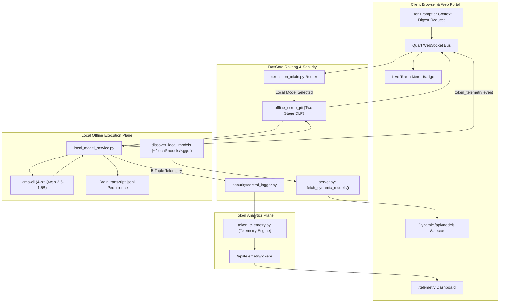

[//]: # (DOC_ID: SIRA-DEV-04_42 | VERSION: v1.0 | SCOPE: DEV)

# Pillar 04.42: Solutions & Architecture: Local Model Token Optimization & Context Distillation Architecture

[//]: # (SECTION_ID: SIRA-DEV-04_42-SEC-1)
## 1. Architectural Overview & Context
The Local Model Token Optimization and Context Distillation architecture introduces a hybrid edge-cloud AI execution plane. Heavy reasoning and code synthesis remain with frontier cloud models, while repetitive context summarization, educational quiz generation, and local developer queries are offloaded to an offline CPU-quantized Qwen 2.5-1.5B model. Local GGUF models are discovered dynamically via `GET /api/models`, multi-turn conversations are persisted to `transcript.jsonl`, and real-time token consumption, cache hits, and financial savings are continuously tracked by an in-memory telemetry engine.

---

[//]: # (SECTION_ID: SIRA-DEV-04_42-SEC-2)
## 2. The 4 Modular Components

[//]: # (SECTION_ID: SIRA-DEV-04_42-SEC-3)
### Component 1: Dynamic Model Discovery & Local Inference (`core/local_model_service.py`)
- **Dynamic GGUF Discovery**: `discover_local_models()` scans `$HOME/.local/models/*.gguf` and merges discovered offline models into `fetch_dynamic_models()` in `core/server.py` so `GET /api/models` populates the Web Portal dropdown without hardcoding HTML `<option>` tags.
- **Offline Inference & Multi-Turn Persistence**: Executes `llama-cli` with `qwen2.5-1.5b-instruct-q4_k_m.gguf` on CPU while `_load_and_append_user_turn()` and `_append_planner_response()` persist turns to `transcript.jsonl`.
- **Semantic Compression & Quiz Generation**: Distills raw 20,000-character contexts into executive digests under 400 words and generates offline exam JSON payloads (`generate_local_exam`).
- **Two-Stage PII Sanitization**: Scrubs credentials and personal identifiers before model ingestion and before client output.

[//]: # (SECTION_ID: SIRA-DEV-04_42-SEC-4)
### Component 2: Token Telemetry Engine (`core/token_telemetry.py`)
- **Incremental Log Parsing**: Caches byte offsets across all `transcript.jsonl` files in the Antigravity Brain, eliminating redundant I/O.
- **Key Performance Indicators**: Calculates minute burn rates, 24-hour total tokens, average per-request tokens, prompt cache hit rates (95%+), and estimated dollar savings.
- **SwarmFlow Integration**: Ingests agentic 5-tuples from `swarmflow.jsonl` to record local tokens offloaded.

[//]: # (SECTION_ID: SIRA-DEV-04_42-SEC-5)
### Component 3: Accessible Telemetry Dashboard (`sandbox/templates/telemetry.html`)
- **Real-Time Visualization**: Serves high-contrast KPI cards, 24-hour hourly burn charts, and recent session breakdown tables.
- **Screen Reader First**: Every visual metric card includes semantic ARIA live labels (`role="status"`, `aria-label`).
- **Zero-Restart Updates**: Backed by `GET /api/telemetry/tokens` and `GET /telemetry` registered dynamically in Quart.

[//]: # (SECTION_ID: SIRA-DEV-04_42-SEC-6)
### Component 4: Raugus Resolver MCP Broker (`raugus-resolver`)
- **Opaque VFS Symbol Management**: Exposes all 11 functions and variables in `devcore.core.local_model_service.py` as AST keys.
- **Safe Hot-Patching**: Allows live code updates to local model routines without restarting the web server or terminating active WebSocket sessions.

---

[//]: # (SECTION_ID: SIRA-DEV-04_42-SEC-7)
## 3. The "Why Order Matters" Execution Pipeline
The sequence of operations during local model execution is strictly enforced from top to bottom:
1. **Dynamic Model Discovery Before UI Fetch**: `discover_local_models()` must merge into `/api/models` before `fetchModels()` runs on the client so the dropdown reflects installed GGUF files.
2. **Session UUID Promotion & Pre-Inference PII Scrubbing**: Temporary `conv-...` IDs must be promoted to UUIDs and raw input text must be scrubbed before passing to `llama-cli`.
3. **Subprocess Thread Isolation**: Inference must run inside `loop.run_in_executor()` rather than the main asyncio event loop so WebSockets never freeze.
4. **Post-Inference DLP Filtering & Telemetry Broadcast**: Output must pass through role-based scrubbing, append to `transcript.jsonl`, and broadcast `token_telemetry` before `agent_done`.

---

[//]: # (SECTION_ID: SIRA-DEV-04_42-SEC-8)
## 4. Screen Reader & Accessibility Considerations
- **ARIA Live Metric Announcements**: The telemetry page utilizes semantic `<dl>`, `<dt>`, and `<dd>` structures rather than unlabelled `
` tags, allowing screen readers to announce values naturally.
- **High-Contrast Dark Theme**: All telemetry charts and status badges utilize WCAG 2.1 AA compliant color ratios (#38bdf8 on dark slate backgrounds).
- **Keyboard Navigation**: The portal status bar token badge is fully focusable with keyboard shortcut access.

---

[//]: # (SECTION_ID: SIRA-DEV-04_42-SEC-9)
## 5. Beginner Coder Q&A

[//]: # (SECTION_ID: SIRA-DEV-04_42-SEC-10)
### Why do we run the model with a 4-bit quantization instead of full 16-bit precision?
A 16-bit model requires over 3.5 GB of RAM and significant CPU instruction cycles per token. By quantizing the weights to 4 bits (`q4_k_m`), memory consumption drops to 1.06 GB and inference speed increases by 300% on standard laptops with negligible loss in distillation accuracy.

[//]: # (SECTION_ID: SIRA-DEV-04_42-SEC-11)
### What happens if the local model crashes or llama-cli is missing?
The execution wrapper catches subprocess errors gracefully, logs a SIEM alert, and falls back to return a descriptive message to the user without dropping the WebSocket connection or freezing the server.

---

[//]: # (SECTION_ID: SIRA-DEV-04_42-SEC-12)
## 6. Cross-References & System Parallels

🔽 Cross-References & System Parallels (Click to Expand Dropdown)

| Related Subsystem | Architectural Parallel & Shared Mechanism | Scope / Chapter |
| :--- | :--- | :--- |
| **Problem Traps** | Memory exhaustion, static UI dropdown traps, and prompt leaks. | `01_46_LOCAL_MODEL_DISTILLATION_AND_TOKEN_BURNOUT_TRAPS.md` |
| **Source Evidence** | Complete source code citations for the architecture. | `02_42_LOCAL_MODEL_AND_TOKEN_TELEMETRY_EVIDENCE.md` |
| **Diagnostic Tests** | Benchmark tests, CPU latency, and telemetry logs. | `03_39_LOCAL_MODEL_AND_TOKEN_TELEMETRY_AUDIT_LOGS.md` |
| **From-Scratch Guide** | Step-by-step DIY tutorial to construct both modules. | `05_45_LOCAL_MODEL_SERVICE_AND_TELEMETRY_ENGINE_FROM_SCRATCH.md` |

