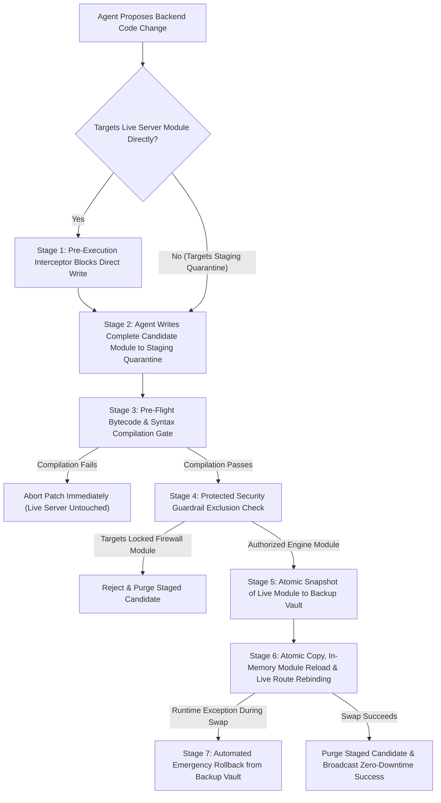

# Zero-Downtime Hot-Patch Architecture & Agentic Code-Mutation Governance

## Executive Overview

In an autonomous AI development environment where an agent is granted administrative capability to evolve, debug, and extend the platform itself, **how code changes reach the running server** is the single most critical factor determining system survival, security integrity, and continuous uptime.

This document outlines the **Zero-Downtime Hot-Patch Sequence**, why it is essential for uninterrupted system availability, and how it neutralizes the fundamental hazard of **autonomous agents modifying core server logic based on publicly available information**.

---

## 1. The Core Problem: Agents Modifying Core Server Files from Public Information

When an autonomous AI agent is tasked with fixing a backend bug, adding an API capability, or optimizing server performance, it relies on two sources of knowledge: its **pre-trained weights** (derived from billions of lines of public repositories, tutorials, and Q&A forums) and **publicly available web documentation**. 

Allowing an agent to directly edit live core server files based on that public knowledge introduces four severe operational and security risks:

### 1.1 The "Edit-and-Restart" Training Bias
Publicly available software engineering tutorials almost universally teach a destructive development loop: *edit the source file directly in place, kill the running server process, and restart it*.
- In a standard stateless web app, a two-second restart is barely noticeable.
- In a **stateful, event-driven streaming portal**—where users rely on persistent WebSocket connections, real-time screen-reader accessibility feeds, monotonic event-delivery queues, and long-running background subprocesses—a hard process restart is catastrophic. Killing the server severs every active client session, orphans running tasks, drops unacknowledged stream chunks, and causes immediate port-binding race conditions.

### 1.2 Generic Framework Assumptions vs. Custom Zero-Trust Architecture
Public documentation for web frameworks (such as Quart, Flask, FastAPI, or Express) demonstrates minimal, unhardened boilerplate. When an agent synthesizes code from public patterns and writes it directly into a live core server module, it frequently:
- Overwrites or bypasses custom Role-Based Access Control (RBAC) tiers, Virtual File System (VFS) resolvers, or Data Loss Prevention (DLP) scrubbers because those custom layers do not exist in public tutorials.
- Introduces blocking synchronous calls inside asynchronous event loops based on generic examples, freezing the entire server for all connected tenants.
- Replaces stateful singleton managers with fresh, empty instances, wiping out active client queues and session ownership mappings.

### 1.3 Unvalidated Hallucinations, Syntax Faults & Poisoned Public Snippets
When an agent adapts code from public sources or generates complex multi-line edits in place:
- A single missing quotation mark, mismatched indentation, or hallucinated import written directly into a live server file immediately corrupts the module on disk.
- If the agent pulls troubleshooting steps or code snippets from untrusted public pages, it may inadvertently ingest **Indirect Prompt Injections** or insecure coding recipes (such as disabling authentication checks or enabling shell execution) designed to weaken the host server.

### 1.4 The Public Documentation Feedback Loop (Reconnaissance Risk)
If a project's own publicly released documentation exposes real internal filenames, physical directory paths, or internal route handlers:
1. **External Attackers** gain an exact map of the backend to craft targeted path-traversal or prompt-injection payloads.
2. **Autonomous Agents** ingesting that public documentation will fixate on the literal filenames and attempt to overwrite those live production files directly, bypassing the platform's staging and verification safeguards.

---

## 2. Why the Hot-Patch Sequence Is Critical for Uptime & System Resilience

To achieve **99.999% continuous availability** while still allowing rapid, autonomous self-improvement, the system enforces a strict architectural separation between **Code Authoring (Quarantine Staging)** and **Code Execution (The Live Runtime)**.

### Key Uptime Guarantees
- **Zero Dropped Connections**: Active WebSocket streams, 4-second keep-alive heartbeats, and screen-reader live regions remain continuously connected throughout a backend upgrade.
- **Zero Event Loss (ACK Queue Continuity)**: The monotonic sequence buffer and client acknowledgment state remain intact in memory while underlying class methods are hot-swapped.
- **Zero Orphaned Subprocesses**: Running tasks and background workloads continue executing without interruption while the surrounding orchestration logic is refreshed.
- **Mathematical Immunity to Syntax Crashes**: Broken code can never reach the live execution directory because compilation verification occurs strictly inside an isolated quarantine zone before any file swap is permitted.

---

## 3. The 7-Stage Zero-Downtime Hot-Patch Sequence

Every modification to backend engine logic must pass through a deterministic, seven-stage pipeline enforced jointly by the **Pre-Execution Memory Interceptor** and the **Hot-Patch Orchestration Engine**.

### Stage 1 — Pre-Execution Interception (Live Engine Immutability)
When an autonomous agent attempts to use any file-editing or write tool directly against a live backend module, the **Pre-Execution Memory Interceptor** halts the tool call before it reaches the operating system. The interceptor returns an explicit denial instructing the agent to route the proposed change through the **Staging Quarantine Directory**.

### Stage 2 — Isolated Quarantine Staging
Instead of performing partial, in-place line replacements on a live file, the agent writes the complete candidate module into an isolated **Staging Quarantine Directory**. At this stage, the candidate code is completely inert and has zero impact on the running application.

### Stage 3 — Pre-Flight Bytecode & Syntax Verification Gate
When the hot-patch sequence is triggered, the engine inspects all candidate modules in the Staging Quarantine Directory and runs strict bytecode compilation verification on each file before touching the live system:
- If any syntax error, indentation fault, or invalid token is detected, the engine **immediately aborts the sequence**, broadcasts a diagnostic alert, and leaves the live server 100% untouched.

### Stage 4 — Protected Security Guardrail Exclusion
To prevent an elevated agent—or an agent influenced by poisoned public data—from weakening the platform's security posture via a staged patch, the Hot-Patch Engine enforces a hard-coded exclusion list:
- Core firewall interceptors, VFS policy maps, offline privacy brokers, and security auditors are **permanently excluded** from hot-patching.
- Any staged candidate matching a protected security guard identifier is automatically rejected and purged.

### Stage 5 — Atomic Snapshot to the Backup Vault
Once a candidate module passes bytecode verification and guardrail checks, the engine copies the currently running, known-good version of the target module into a dedicated **Backup Vault** prior to overwriting the live file.

### Stage 6 — In-Memory Hot-Swap, Route Rebinding & State Preservation
The engine copies the validated candidate into its live destination and executes an in-memory hot-swap:
1. **State Capture**: Active client WebSocket queues, running subprocess handles, task timers, and active workspace pointers are captured in memory.
2. **Dynamic Module Reload**: Backend managers and security helpers are reloaded in-process without terminating the parent server loop.
3. **Live Route Rebinding**: Updated HTTP and WebSocket view handlers are dynamically rebound onto the active application router so endpoint logic updates take effect immediately without restarting the listener port.
4. **State Restoration & Cleanup**: Captured client connections and task states are re-attached to the refreshed manager instances, and the consumed candidate file is removed from the Staging Quarantine Directory.

### Stage 7 — Automated Emergency Rollback Watchdog
If a candidate module passes static syntax compilation but throws a runtime exception during in-memory reload or class initialization:
1. The **Rollback Watchdog** catches the exception before it can crash the server process.
2. It immediately restores the known-good module from the **Backup Vault** back to the live path.
3. It re-imports the stable module, restores all active client connections, and broadcasts a rollback notification—guaranteeing uninterrupted service even when an agent writes faulty runtime logic.

---

## 4. Summary of Architectural Safeguards

| Threat / Failure Mode | Traditional Direct-Edit Agent | Enforced Hot-Patch Architecture |
| :--- | :--- | :--- |
| **Agent introduces a syntax error** | Live server crashes on reload; port drops | Caught in Stage 3 Quarantine; live server untouched |
| **Agent kills/restarts port to apply changes** | All WebSockets, tasks, and queues dropped | Prohibited; Stage 6 hot-swaps classes and routes in memory |
| **Agent applies broken public boilerplate** | Corrupts live state; requires manual git reset | Caught in Stage 7; auto-restores snapshot from Backup Vault |
| **Agent attempts to hot-patch the firewall** | Security controls silently weakened | Blocked by Stage 1 Self-Protection & Stage 4 Guardrail Exclusion |
| **Public docs leak internal file paths** | Attackers and agents target live files directly | Public docs use abstract VFS terminology; live paths remain obfuscated |

---

## 5. Dual-Layer Uptime Protection: Combining Pre-Flight Self-Healing with Live Hot-Patching

The **Zero-Downtime Hot-Patch Sequence** operates in tandem with the **Bootstrap Pre-Flight Supervisor & Persistent Connection Gateway** (documented in `BOOTSTRAP_PREFLIGHT_ARCHITECTURE.md`) to provide two complementary layers of uptime defense against rogue or hallucinating agents:

1. **Layer 1 — The Self-Healing Pre-Flight Check & Persistent Gateway (Boot & Crash Recovery)**:
   - Audits all 15 engine modules via bytecode compilation prior to port binding and immediately after any unexpected crash.
   - Automatically restores corrupted modules in `< 5ms` from the **Backup Vault** (seeded during Layer 2 hot-patches), or spawns the **Emergency Auto-Repair Agent** into the **Staging Quarantine Directory** if no valid backup exists.
   - Maintains a **Persistent WebSocket & HTTP Gateway** that holds client and agent connections open across backend reloads, buffering incoming messages while the engine restarts and replaying them automatically upon reconnection.
2. **Layer 2 — The Zero-Downtime Hot-Patch Engine (Live Runtime Evolution)**:
   - Intercepts direct writes to live engine modules and forces all agent code mutations through the **Staging Quarantine Directory**.
   - Compiles candidate code before applying, snapshots known-good modules into the **Backup Vault**, hot-swaps classes and routes in memory while preserving active WebSocket queues and running agent subprocesses, and automatically rolls back if a runtime error occurs.

