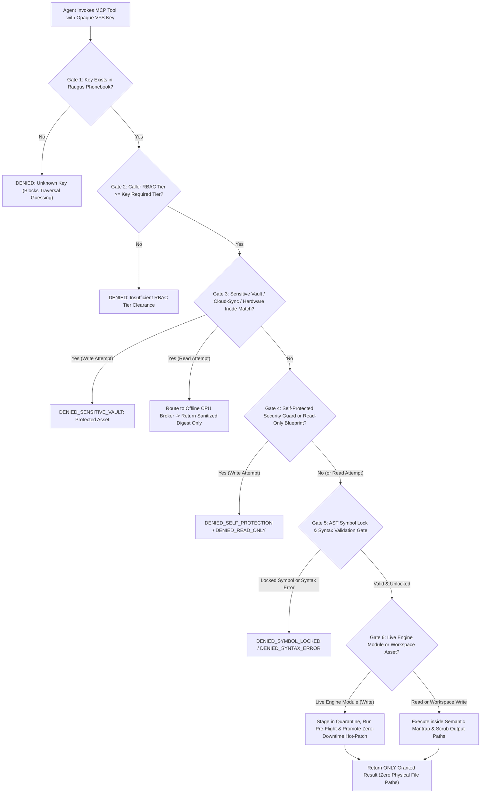

# Raugus Resolver MCP Architecture: Opaque Key-Only Virtual File System (VFS) Broker

## Executive Overview

In standard AI-assisted development environments, agents interact with a codebase by reading and writing **physical operating-system file paths**. While convenient for single-user local scripts, exposing physical filesystem paths to an autonomous cloud LLM introduces severe security, privacy, and stability hazards:

1. **Filesystem Reconnaissance & Path Traversal**: Once an agent knows the host's directory hierarchy, a prompt injection or hallucinated shell command can attempt relative path traversal (`../`), wildcard globbing, or direct file reads outside its intended scope.
2. **Whole-File Overwrite Blast Radius**: Traditional file tools operate on entire files or fragile character-matching blocks. When an agent only needs to inspect or update a single 10-line function or configuration variable, giving it the entire 800-line file increases token consumption and risks accidental corruption of neighboring functions.
3. **Bypass of Granular Function-Level Locks**: A file may contain both developer-editable helper functions and security-critical authentication routines. Path-based file tools cannot natively isolate a single function or variable without exposing the surrounding module.

To solve this at the protocol layer, the platform implements the **Raugus Resolver Model Context Protocol (MCP) Broker**—an **Opaque Key-Only Virtual File System (VFS)** where **physical file paths are never revealed to or accepted from the agent**.

---

## 1. The Opaque Key-Only Access Paradigm

Under the Raugus VFS Protocol, the agent interacts with the workspace exclusively through **Cryptographic / Semantic VFS Keys**:
- **Module Keys**: Represent an abstract module container (e.g., `vfs.engine.system_router`).
- **Symbol Keys (`<module_key>::<symbol_name>`)**: Represent an individual function, asynchronous handler, class, or module-level variable inside that container (e.g., `vfs.engine.system_router::verify_preflight_state` or `vfs.engine.system_router::PROTECTED_GUARD_SET`).

### Core Zero-Trust Guarantees
- **Private In-Memory Path Resolution**: Only the Raugus Resolver MCP Broker holds the mapping table (the **Raugus Phonebook**) that links an abstract VFS Key to a physical storage location. That physical path exists strictly inside private server RAM during rule evaluation and is **never serialized** in any MCP response.
- **Deterministic Host-Path Scrubbing**: Every outgoing MCP payload—whether source code, variable values, topic digests, or error messages—passes through a deterministic path-redaction filter that masks any residual OS path patterns as `<RAUGUS_VFS_ROOT>` or `<REDACTED_HOST_PATH>`.
- **Rule-First Grant Model**: The agent submits a key and a desired operation. The Resolver locates the key in the Phonebook, evaluates all six security and syntax gates, executes the operation internally if and only if every rule is satisfied, and returns **only the granted result** back to the agent.

---

## 2. The 6-Gate Rule Evaluation Pipeline

Every request arriving at the Raugus Resolver MCP Broker must pass six sequential security gates before a result is returned or a mutation is committed.



### Gate 1 — VFS Phonebook Existence & Anti-Traversal Gate
Because the Broker only accepts registered VFS Keys (`<namespace>.<module>` or `<namespace>.<module>::<symbol>`), traditional path-traversal strings (`../../etc/passwd`, `%2e%2e%2f`, or raw drive letters) fail key lookup immediately. If a key does not exist in the Raugus Phonebook, the request is rejected before touching the filesystem.

### Gate 2 — Role-Based Access Control (RBAC) Tier Clearance Gate
Each key in the Phonebook carries a mandatory `required_tier` (`Tier 1` Guest through `Tier 5` System Administrator). If the caller's `user_tier` is lower than the key's `required_tier` (or its parent module's `required_tier`), access is denied and logged to the central SIEM audit stream.

### Gate 3 — Sensitive Vault, Cloud-Sync & 64-Bit Hardware Inode (`st_ino`) Gate
Before reading or modifying any resolved target, the Broker checks three sensitivity layers:
1. Explicit `"sensitive": true` flags on the key or parent namespace.
2. Automatic personal cloud-sync root detection.
3. **64-Bit Hardware Inode (`st_ino`) Fingerprinting**, ensuring that even if a protected directory was renamed, its underlying filesystem inode remains locked.
- **On Read**: Raw source or document text is **never** returned. Instead, the Broker invokes the air-gapped **Local CPU Inference Broker** and returns `GRANTED_SANITIZED_DIGEST_ONLY` containing only a PII-scrubbed, de-identified topic summary (with all target paths stripped).
- **On Write**: Immediately rejected with `DENIED_SENSITIVE_VAULT`.

### Gate 4 — Self-Protection & Read-Only Blueprint Lock Gate
- **Self-Protection Lock**: Keys corresponding to security hooks, VFS maps, offline privacy brokers, security auditors, and the Raugus Resolver MCP Broker itself are permanently locked against modification (`DENIED_SELF_PROTECTION`).
- **Read-Only UI Blueprints**: Keys mapped to immutable frontend application templates return `DENIED_READ_ONLY` on any write attempt, enforcing the platform's Zero-Modification Blueprint doctrine.

### Gate 5 — Granular AST Symbol Lock & Syntax Validation Gate
When the agent reads or writes a specific symbol key (`<module_key>::<symbol_name>`):
- **Isolated Symbol Extraction (Read)**: The Broker parses the module's Abstract Syntax Tree (AST) in memory, locates the exact start and end lines of that specific function, class, or variable assignment, and returns **only that symbol's code block**—keeping the rest of the file hidden.
- **Function-Level Write Lock & Mantrap Serialization (Write)**: Inside the OS-level **Semantic Mantrap** concurrency lock, the Broker checks whether the target symbol (or any symbol overlapped by a module write) is marked locked (`permissions.write == false` or `locked == true`).
- **Pre-Commit AST Syntax Gate**: The Broker splices the proposed code into a candidate copy in memory and parses the entire resulting module with `ast.parse()`. If the agent hallucinated invalid syntax or broken indentation, the Broker rejects the request with `DENIED_SYNTAX_ERROR` before a single byte is written to disk.

### Gate 6 — Automatic Zero-Downtime Hot-Patch Routing Gate
When a `write_by_key` request passes Gates 1–5 on a live backend engine key:
- The agent does not need to know where the staging directory is or how to trigger a reload.
- The Resolver MCP Broker **automatically stages the validated module into the Hot-Patch Quarantine**, runs the **Bootstrap Pre-Flight Bytecode Check**, snapshots the previous version into the **Backup Vault**, promotes the update, and synchronizes live routes in memory—returning `delivery_mode: "HOT_PATCH_PROMOTED"` to the agent.

---

## 3. MCP Tool Reference & Sanitized Payloads

### 3.1 `search_keys(query, entry_type="all", user_tier=5, limit=30)`
Searches the Raugus Phonebook by keyword and returns matching VFS keys and their permission metadata—never physical paths.

**Example Response:**
```json
{
  "status": "GRANTED",
  "query": "preflight",
  "user_tier": 5,
  "count": 2,
  "keys": [
    {
      "key": "vfs.engine.system_router::api_bootstrap_preflight",
      "type": "symbol",
      "symbol_name": "api_bootstrap_preflight",
      "required_tier": 5,
      "permissions": {
        "read": true,
        "write": true,
        "execute": false
      },
      "sensitive": false
    }
  ]
}
```

### 3.2 `list_module_keys(module_key, user_tier=5)`
Lists all function, async function, class, and variable keys (`<module_key>::<symbol_name>`) inside a module key along with their line spans and delivery modes.

**Example Response:**
```json
{
  "status": "GRANTED",
  "module_key": "vfs.engine.system_router",
  "required_tier": 5,
  "module_permissions": {
    "read": true,
    "write": true,
    "delivery_mode": "ALLOWED_HOT_PATCH"
  },
  "symbol_count": 2,
  "symbols": [
    {
      "key": "vfs.engine.system_router::PROTECTED_GUARD_SET",
      "symbol_name": "PROTECTED_GUARD_SET",
      "kind": "variable",
      "line_span": 9,
      "permissions": {
        "read": true,
        "write": true,
        "delivery_mode": "ALLOWED_HOT_PATCH"
      }
    },
    {
      "key": "vfs.engine.system_router::api_bootstrap_preflight",
      "symbol_name": "api_bootstrap_preflight",
      "kind": "async_function",
      "line_span": 8,
      "permissions": {
        "read": true,
        "write": true,
        "delivery_mode": "ALLOWED_HOT_PATCH"
      }
    }
  ]
}
```

### 3.3 `read_by_key(key, user_tier=5)`
Retrieves the exact source code or value of a single function, class, variable, or module purely by its VFS Key after verifying all security rules.

**Example Response (Symbol Key):**
```json
{
  "status": "GRANTED",
  "key": "vfs.engine.system_router::api_bootstrap_preflight",
  "module_key": "vfs.engine.system_router",
  "symbol_name": "api_bootstrap_preflight",
  "kind": "async_function",
  "line_count": 8,
  "permissions": {
    "read": true,
    "write": true,
    "delivery_mode": "ALLOWED_HOT_PATCH"
  },
  "result": "async def api_bootstrap_preflight():\n    ..."
}
```

### 3.4 `write_by_key(key, new_code, user_tier=5)`
Updates a specific function, class, variable (`<module_key>::<symbol_name>`), or module (`<module_key>`) by key, enforcing AST locks, syntax compilation, and automatic hot-patch promotion.

**Example Response:**
```json
{
  "status": "GRANTED",
  "key": "vfs.engine.system_router::api_bootstrap_preflight",
  "module_key": "vfs.engine.system_router",
  "delivery_mode": "HOT_PATCH_PROMOTED",
  "updated_symbol_keys": [
    "vfs.engine.system_router::PROTECTED_GUARD_SET",
    "vfs.engine.system_router::api_bootstrap_preflight"
  ]
}
```

### 3.5 `refresh_key_map(user_tier=5)`
Re-indexes workspace AST symbol keys and 64-bit hardware inodes in the Raugus Phonebook and returns only aggregate key counts (`total_keys`, `file_keys`, `symbol_keys`).

---

## 4. Security Verification Summary

The Raugus Resolver MCP Broker is continuously verified by the **Automated Workspace Tool Security Auditor**:
- **Stage 3 AST Static Code Hygiene**: Confirms the MCP server contains **zero external HTTP client imports** (100% air-gapped), zero `shell=True` subprocess calls, and zero `eval`/`exec` primitives.
- **Stage 5 Opaque Key-Only Verification**: Automatically tests `search_keys`, `list_module_keys`, `read_by_key`, and `write_by_key` to guarantee zero physical host path leaks, strict Tier 3 vs. Tier 5 RBAC enforcement, isolated AST symbol extraction, Sensitive Vault digest-only routing, Read-Only blueprint protection, Self-Protection guard locks,     and pre-write syntax error rejection.
