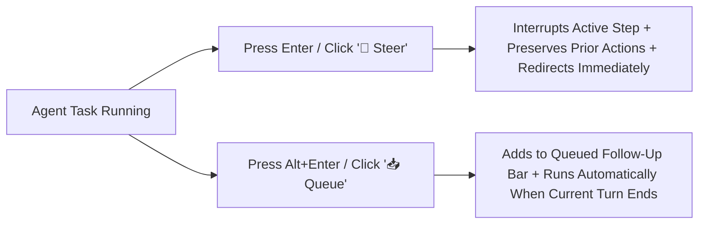

# Siraugga / Antigravity Web Portal — User Manual & Guide

> [!NOTE]
> This manual is structured with clean, semantic headings (H1–H3) and concise tables for rapid screen reader navigation using the **`H`**, **`2`**, **`3`**, **`T`**, **`E`**, and **`B`** quick-navigation keys.

---

## 1. Quick Start & Interface Overview

The **Siraugga Command Center** is an accessible, zero-restart web portal that connects your browser to the local AI engine and interactive plugins over a resilient, ACK-backed WebSocket stream.

### Core Regions of the Interface
1. **Top Header Bar**:
   - **Connection Badge**: Announces live connection health (`Connected`, `Reconnecting...`, or `Disconnected`).
   - **Active Task Banner**: Appears while the agent is working; displays the active prompt, model badge, elapsed timer, and a **Cancel** button.
   - **Model Selector**: Choose between available reasoning models (such as `Gemini 4 Argon (High)`, `Gemini 3.8 Flash (High)`, `Claude Opus 5.5`, or `Claude Sonnet 5.5`).
   - **Settings & Sessions Button**: Opens the side drawer for role switching, workspace selection, session history, and hot-reload tools.
2. **Conversation Feed (`main`)**:
   - Every user prompt and agent response is rendered as an `<article>` with an **`H2`** heading so screen reader users can press **`H`** or **`2`** to jump between messages.
   - Markdown subheadings inside agent responses are automatically capped at **`H3`–`H6`** so they never collide with message-level **`H2`** navigation.
3. **Chat Input Bar**:
   - Supports multi-line prompts, slash-command autocomplete (`/`), automatic local draft saving, and **Dual-Mode Mid-Task Input** (**Steer Now** and **Queue Next**).

---

## 2. Keyboard Shortcuts & Screen Reader Navigation

| Shortcut | Context | Action |
| :--- | :--- | :--- |
| **`H`** or **`2`** | Browse Mode | Jump between User and Agent messages in the Conversation Feed |
| **`3`** – **`6`** | Browse Mode | Navigate sections/subheadings inside an Agent response |
| **`E`** | Browse Mode | Jump directly to the Chat Input box or an open Artifact Raw Editor `<textarea>` |
| **`B`** | Browse Mode | Jump between interactive buttons (Execute/Steer, Queue, Flip Card, Copy Code) |
| **`Alt + C`** | Global | Move focus immediately into the Chat Input box |
| **`Alt + H`** | Global | Open the interactive Help Menu in the chat feed |
| **`Alt + S`** | Global | Pre-fill the *"Create a new Sandbox Environment"* quick prompt |
| **`Alt + L`** | Global | Pre-fill the *"Analyze system logs for the last 24 hours"* quick prompt |
| **`Alt + T`** | Global | Jump focus directly into the active **Exam Application** iframe |
| **`Alt + N`** | Global / Exam | Jump focus to the active **Media Player** iframe (or **Submit / Next Question** when inside an Exam) |
| **`Enter`** | Chat Input | **Idle**: Execute prompt · **While Task Running**: **Steer Now** (interrupt & redirect immediately) |
| **`Alt + Enter`** (or **`Ctrl + Enter`**) | Chat Input (Busy) | **Queue Next** — queue follow-up context for the next turn without interrupting the active step |
| **`Shift + Enter`** | Chat Input | Insert a line break without submitting |

---

## 3. Mid-Task Steering & Live Context Injection

You never need to wait for a long task to finish if you spot the agent going in the wrong direction or realize you forgot to include an important detail. While a task is running, the input bar automatically switches into **Dual-Mode Mid-Task Input**:

### Mode A: Steer Now (Immediate Course-Correction)
- **When to use**: You hear or see the agent's live tool calls/reasoning heading down the wrong path, or you need to change constraints right now.
- **How to trigger**: Type your correction in the chat box and press **`Enter`** (or click the amber **`🎯 Steer`** button).
- **What happens**:
  1. The current `agy` process is cleanly interrupted (marked `↪ Redirected` instead of an error).
  2. The server packages your **original prompt**, **all tool actions completed before the interrupt**, **any partial output**, and **your new course-correction** into a `<MID_TASK_STEERING_UPDATE>` envelope.
  3. The agent immediately resumes on the **same Conversation ID** with full memory of what it already did.

### Mode B: Queue Next (Non-Destructive Context Injection)
- **When to use**: The agent is running a valid step (e.g., running tests or editing a file) and you remember an extra instruction you want handled next without killing the current tool call.
- **How to trigger**: Type your additional context and press **`Alt + Enter`** / **`Ctrl + Enter`** (or click the indigo **`📥 Queue`** button).
- **What happens**:
  1. Your message appears in the live **Queued Follow-Up Context Bar** right above the chat box.
  2. You can queue multiple items; as soon as the current turn completes, all queued items are combined in order and executed automatically.
  3. At any time while waiting, you can click **`🎯 Steer Now`** in the Queue Bar to promote your queued messages into an immediate interrupt, or **`✕ Clear`** to remove them.

### Hard Stop (`Cancel`)
- Clicking the **Cancel** button on the active task banner immediately terminates the agent process and all child subagents (**Zero-Idle Protocol**) and clears any pending queued messages.

---

## 4. Slash Commands & Built-in Interactive Plugins

Type `/` in the chat input box to open the accessible Slash Command listbox (navigate with **Up/Down Arrow** and press **Enter**), or type any command directly:

### 4.1 `/clear` — Clear Chat Feed
- Clears the current visual chat feed while keeping your backend workspaces intact.

### 4.2 `/media` — Accessible Media Player
- **Usage**:
  - Type `/media` to launch the **Siraugga Accessible Media Player** iframe.
  - Type `/media play <song or topic>` to search and load a specific video.
  - Ask in natural language: *"Add this video to my playlist"*, *"Remove item 2 from my playlist"*, or *"Resume my last video"*.
- **Accessibility**: Press **`Alt + N`** at any time to jump focus directly inside the Media Player controls (`Play/Pause`, `Rewind 10s`, `Fast Forward 10s`, `Volume`, and `Autoplay Next`).

### 4.3 `/builder` & Exam Generator — Dynamic Quizzes & Exams
- **Usage**:
  - Type `/builder` to open the **Visual Exam Builder Dashboard**, or ask the agent in plain language: *"Create a 5-question multiple-choice and short-answer quiz from my study folder with a 10-minute timer."*
  - Type `help exam` at any time for copy-and-paste starter prompts.
- **Live Capabilities**:
  - Supports **Anti-Cheat Mode**, custom timers, retakes of past exams, resuming unfinished exams, and mid-exam visual customization (e.g., *"Change the exam timer to 20 minutes"*).
  - Press **`Alt + T`** to focus the active Exam iframe, and **`Alt + N`** inside the exam to submit an answer or advance to the next question.

### 4.4 `/background` — Detached Background Workloads
- **Usage**:
  - Type `/background` or instruct the agent to run a long-running script in the background.
  - The agent detaches the process and automatically wakes up via a local webhook ping as soon as the job finishes.

---

## 5. Interactive Artifact Viewer (Flip-Cards)

When the agent generates an `.md` artifact (such as an Implementation Plan or Guide), a **Flip-Card** widget is rendered in the chat stream.

1. **Reading & Editing (Admins)**:
   - Activate the **`Flip to read <Artifact Name>`** button.
   - The card flips and **automatically moves focus** into a native `<textarea class="artifact-raw-editor">` containing the raw Markdown so screen readers can read and edit line-by-line (or jump to it with the **`E`** key).
   - Click **`Proceed`** to save your edits and instruct the agent to execute the plan.
2. **Role-Scoped Summaries (Developers & Guests)**:
   - **GameDev (`dev`)**: Clicking the artifact requests an automatic technical summary with root credentials and Tier 5 system secrets scrubbed.
   - **Guest / Modder (`mod`)**: Clicking the artifact requests a high-level, non-technical summary without exposing backend source code.

---

## 6. Roles, Workspaces, Sessions & System Controls

Open the **Settings & Sessions** panel from the top-right header button to manage your environment:

### 6.1 Role-Based Access Control (RBAC) Accounts
| Account (`User / Pass`) | Role Tier | Permissions & Boundaries |
| :--- | :--- | :--- |
| **`admin` / `admin`** | Tier 5 (`super_admin`) | Full machine access by default (no sandbox); protected at the AST function/variable level by the **Raugus Map** interceptor. |
| **`dev` / `dev`** | Tier 3 (`gamedev`) | Confined strictly to assigned project workspaces (`game_demo`, `npc_quest`) with `--sandbox` enforced. |
| **`mod` / `mod`** | Tier 2 (`modder`) | Read-only access to safe workspace game assets; file modifications and core files are blocked. |

> [!IMPORTANT]
> **Zero-Trust Privilege Enforcement**: Super Admins automatically receive full machine access by default with the **Raugus Map** (`PreToolUse` AST Firewall) guarding critical read-only functions. Lower-tier roles (`dev`, `mod`, `guest`) are permanently locked into `--sandbox` mode on the backend with no client-side bypass controls.

### 6.2 Project Workspaces & Brain Sessions
- **Project Workspace Selector**: Switch the active working directory (`cwd`) for `agy`, create a new project folder (`+ New`), or clear project-specific sessions (`🗑️ Clear`).
- **Session Selector**: Switch between historical Antigravity Brain conversations, start a fresh session (`✨ New Session`), rename the current session (`✏️ Rename`), delete a single session (`🗑️ Delete`), or sanitize all sessions (`🧹 Clear All`).

### 6.3 Zero-Restart Maintenance Controls
- **`↻ Reload Scripts`**: Hot-reloads `agent_manager`, `execution_mixin`, `security_manager`, `project_manager`, and `session_manager` in memory (`POST /api/reload`) without dropping active WebSocket connections or restarting Port 5000.
- **`🛡️ Auto-Patch Event`**: Simulates the zero-downtime syntax verification, backup, hot-patch, and automatic rollback sequence.
- **Massive Prompt Ingestion**: Prompts exceeding 10,000 characters are automatically uploaded over HTTP (`/api/prompt/massive`), scrubbed for PII, saved to `.agents/massive_prompts/`, and handed to the agent without overflowing WebSocket frame limits.
